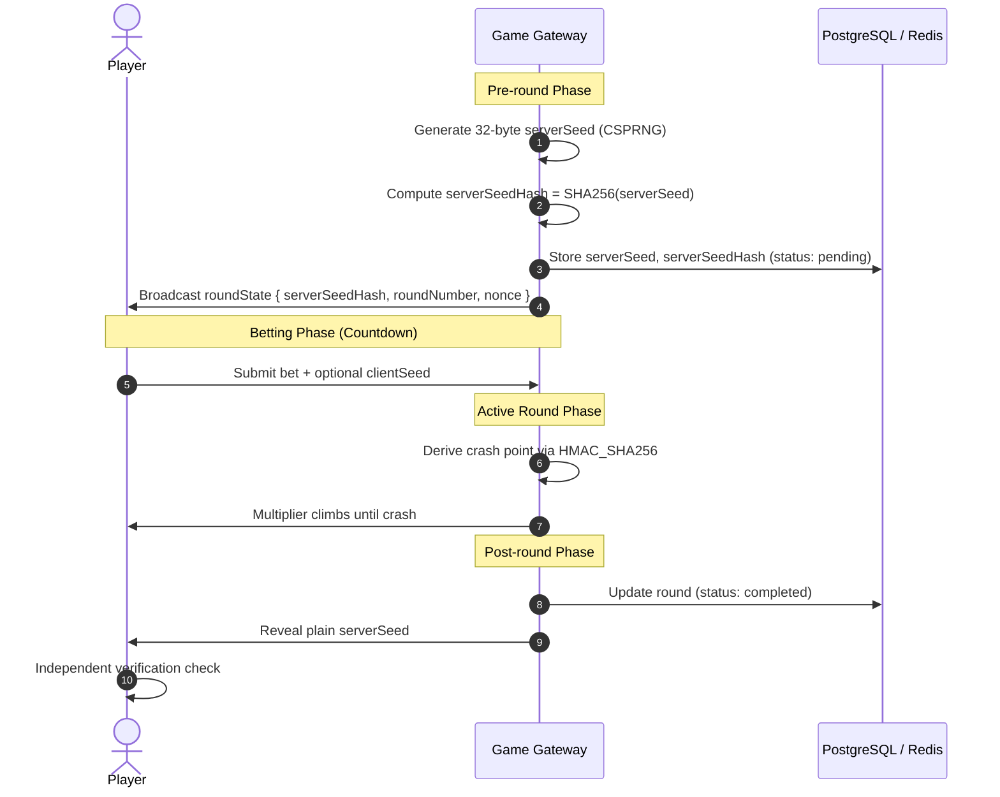
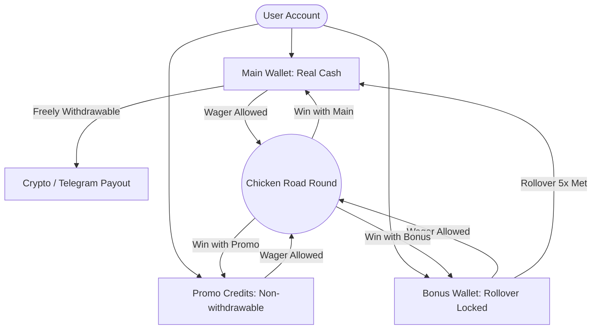
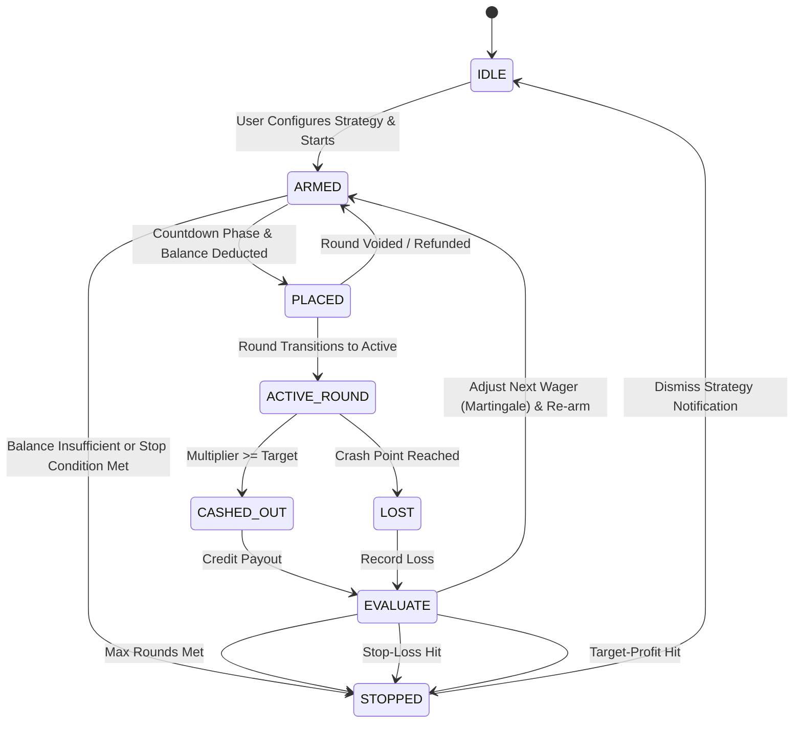

# Chicken Road: System Architecture & Game Systems Specification

This document provides the authoritative, engineering-grade technical specifications for the core game mathematics, provably fair algorithms, financial ledger rules, real-time networking, disaster recovery, and anti-fraud architecture for **Chicken Road**.

---

## 1. RTP & House Edge Math

### 1.1 Probability Distribution Model
Chicken Road operates as a continuous multiplier crash game. The core crash point $M$ is sampled from a heavy-tailed continuous probability distribution parameterized by the house edge $e \in (0, 1)$:

$$P(M \ge m) = \frac{1 - e}{m} = \frac{\text{RTP}}{m} \quad \text{for } m \ge 1.00$$

Where:
- $e$: House Edge (e.g., $e = 0.03$ for $3\%$)
- $\text{RTP} = 1 - e$: Return to Player (e.g., $0.97$ for $97\%$)
- $m$: Multiplier target ($m \in [1.00, M_{\max}]$)

#### Invariant Return to Player
For any cash-out target $m \ge 1.00$, the expected value $E[V]$ of a $1.00$ wager is strictly constant:

$$E[V] = m \cdot P(M \ge m) + 0 \cdot P(M < m) = m \cdot \left(\frac{1 - e}{m}\right) = 1 - e = \text{RTP}$$

Players cannot alter their statistical expectation by selecting different cash-out targets; whether cashing out at $1.05\text{x}$ or $500.00\text{x}$, the theoretical RTP remains identically $97.00\%$.

### 1.2 Inverse-Transform Sampling Formula
Let $u$ be an ideal pseudo-random variable drawn uniformly from the half-open interval $[0, 1)$, generated via HMAC-SHA256:

$$u \sim \text{Uniform}[0, 1)$$

The cumulative distribution function (CDF) is:

$$F(m) = P(M < m) = 1 - \frac{1 - e}{m}$$

Setting $u = F(m)$ and solving for $m$:

$$u = 1 - \frac{1 - e}{m} \implies 1 - u = \frac{1 - e}{m} \implies m = \frac{1 - e}{1 - u}$$

To protect the house edge from floating-point rounding bias, all multiplier calculations are **strictly truncated (floored)** to two decimal places:

$$M_{\text{raw}} = \frac{1 - e}{1 - u}$$

$$M_{\text{final}} = \min\left(M_{\max}, \max\left(1.00, \frac{\lfloor M_{\text{raw}} \cdot 100 \rfloor}{100}\right)\right)$$

Where $M_{\max}$ is the system exposure ceiling (default: $10,000.00\text{x}$).

### 1.3 Instant Crash Probability
An instant crash occurs when the sampled crash multiplier evaluates to less than $1.01\text{x}$, resulting in an unavoidable loss for all players:

$$P(M < 1.01) = 1 - P(M \ge 1.01) = 1 - \frac{1 - e}{1.01}$$

For $e = 0.03$ ($3\%$ house edge):

$$P(M < 1.01) = 1 - \frac{0.97}{1.01} = 1 - 0.960396 = 0.039604 \approx 3.96\%$$

Approximately $3.96\%$ of rounds end instantly at $1.00\text{x}$ (the chicken does not take flight).

### 1.4 Admin Configuration & Worked Examples

#### Relationship & Live Configuration
- $\text{RTP} = 1.00 - \text{House Edge}$
- Configured in the admin dashboard in basis points ($1 \text{ bp} = 0.01\%$) or decimal ($0.0300$).
- Changes are written to Redis (`config:house_edge`) and committed to PostgreSQL (`game_settings`).
- **Safety Invariant**: Admin updates apply **only to round $N+1$ onwards**. Active or committed rounds retain the parameters established at seed commitment.

#### Worked Examples ($e = 0.03$, $\text{RTP} = 0.97$, $M_{\max} = 10,000.00\text{x}$)

| Sample $u$ | Value of $(1 - u)$ | Unfloored $M_{\text{raw}} = \frac{0.97}{1 - u}$ | Floored Multiplier $M_{\text{final}}$ | Outcome Description |
| :--- | :--- | :--- | :--- | :--- |
| **$0.00000000$** | $1.00000000$ | $0.970000$ | **$1.00\text{x}$** | Lowest boundary; instant crash |
| **$0.02500000$** | $0.97500000$ | $0.994871$ | **$1.00\text{x}$** | Instant crash ($u < e$) |
| **$0.50000000$** | $0.50000000$ | $1.940000$ | **$1.94\text{x}$** | Median flight |
| **$0.80000000$** | $0.20000000$ | $4.850000$ | **$4.85\text{x}$** | Moderate multiplier |
| **$0.95000000$** | $0.05000000$ | $19.400000$ | **$19.40\text{x}$** | Top 5% climb |
| **$0.99900000$** | $0.00100000$ | $970.000000$ | **$970.00\text{x}$** | Rare high flyer (0.1% probability) |
| **$0.99999000$** | $0.00001000$ | $97,000.000000$ | **$10,000.00\text{x}$** | Extreme sample clamped to $M_{\max}$ |

---

## 2. Provably Fair — Exact Algorithm

### 2.1 Seed Generation & Commit-Reveal Protocol



1. **Server Seed**: 32 bytes of cryptographically secure random bytes generated via `crypto.randomBytes(32).toString('hex')` (64-character hex string).
2. **Server Seed Hash**: `SHA-256(serverSeed)` published in the `roundState` WebSocket payload before round betting begins.
3. **Client Seed**: A player-supplied string (or decentralized seed). Default in Telegram Mini App is a composite of the active room's user bets, or the user's custom seed defined in their Profile.
4. **Nonce**: Monotonically incrementing 64-bit integer tracking the sequential index of rounds generated under the current seed pair.

### 2.2 Derivation Pipeline
The binary hash is calculated using HMAC-SHA256:

$$\text{hmac} = \text{HMAC\_SHA256}(\text{key} = \text{serverSeed}, \text{msg} = \text{clientSeed} : \text{nonce})$$

The first 4 bytes (32 bits) of the HMAC digest are extracted as an unsigned big-endian integer $h$:

$$h = \sum_{i=0}^{3} \text{byte}_i \cdot 256^{3 - i} \quad (0 \le h < 2^{32})$$

$$u = \frac{h}{2^{32}} \in [0, 1)$$

$$M = \min\left(M_{\max}, \max\left(1.00, \frac{\lfloor (1 - e) / (1 - u) \cdot 100 \rfloor}{100}\right)\right)$$

### 2.3 Verification API Endpoint Contract

#### Request
```http
GET /api/v1/round/verify/1042 HTTP/1.1
Host: api.chickenroad.io
Accept: application/json
```

#### Response (`200 OK`)
```json
{
  "roundNumber": 1042,
  "serverSeed": "a3f5c789b1d2e3f4a5b6c7d8e9f0123456789abcdef0123456789abcdef01234",
  "serverSeedHash": "7b8d4e98f01a3b5c7d9e1f3a5b7c9d1e3f5a7b9c1d3e5f7a9b1c3d5e7f9a1b3c",
  "clientSeed": "player_seed_987123",
  "nonce": 1042,
  "houseEdge": 0.03,
  "rawUint32": 2147483648,
  "uniformFloat": 0.5,
  "crashMultiplier": 1.94,
  "verified": true
}
```

### 2.4 Standalone Verification Code Snippet (Browser & Node.js)
Players can verify any completed round in their browser console or Node.js runtime without external libraries:

```javascript
/**
 * Independent verification function for Chicken Road
 * Compatible with Node.js and modern browser environments
 */
async function verifyChickenRoadRound({ serverSeed, serverSeedHash, clientSeed, nonce, houseEdge = 0.03, expectedCrash }) {
  // 1. Verify Server Seed Hash Commitment
  const enc = new TextEncoder();
  const hashBuffer = await crypto.subtle.digest('SHA-256', enc.encode(serverSeed));
  const computedHash = Array.from(new Uint8Array(hashBuffer))
    .map((b) => b.toString(16).padStart(2, '0'))
    .join('');

  const hashMatch = computedHash.toLowerCase() === serverSeedHash.toLowerCase();

  // 2. Derive HMAC-SHA256
  const key = await crypto.subtle.importKey(
    'raw',
    enc.encode(serverSeed),
    { name: 'HMAC', hash: 'SHA-256' },
    false,
    ['sign']
  );
  const message = `${clientSeed}:${nonce}`;
  const sigBuffer = await crypto.subtle.sign('HMAC', key, enc.encode(message));
  const bytes = new Uint8Array(sigBuffer);

  // 3. Extract first 4 bytes as Big-Endian uint32
  const view = new DataView(bytes.buffer);
  const h = view.getUint32(0, false);
  const u = h / Math.pow(2, 32);

  // 4. Invert CDF to obtain crash point
  const rawCrash = (1 - houseEdge) / (1 - u);
  const crashMultiplier = Math.max(1.00, Math.floor(rawCrash * 100) / 100);

  return {
    validCommitment: hashMatch,
    computedCrash: crashMultiplier,
    matchesReported: Math.abs(crashMultiplier - expectedCrash) < 0.001,
    details: { h, u, computedHash }
  };
}

// Example execution:
verifyChickenRoadRound({
  serverSeed: "d1f2e3a4b5c6d7e8f90112233445566778899aabbccddeeff001122334455667",
  serverSeedHash: "3b3f46f4997092c4e7ab5d1656828945657064a78726588a44c5ff4c3b6e7039",
  clientSeed: "global_seed",
  nonce: 42,
  houseEdge: 0.03,
  expectedCrash: 2.45
}).then(console.log);
```

---

## 3. Wallet Rules & Ledger Accounting

### 3.1 Wallet Taxonomy



1. **Main Wallet (Real Cash)**:
   - Funded by fiat / cryptocurrency deposits or bonus turnover completions.
   - Withdrawable subject to standard KYC/AML turnover.
   - Wagers placed with Main Wallet pay winnings directly into Main Wallet.
2. **Bonus Wallet (Restricted Funds)**:
   - Funded by promotional match bonuses, referral incentives, or deposit matches.
   - Subject to strict turnover/wagering multipliers (e.g., $5\text{x}$).
   - Winnings derived from bonus wagers return to the Bonus Wallet until wagering is completed.
3. **Promotional Credits (Play Money / Free Bets)**:
   - Non-withdrawable trial balances or loyalty tokens.
   - Payouts return either net winnings to Bonus Wallet or promotional credits.

### 3.2 Wagering & Rollover Requirements

$$\text{Rollover Target} = \text{Bonus Principal} \times \text{Wagering Multiplier}$$

- **Standard Multiplier**: $5\text{x}$ (e.g., a 100 CR bonus requires $500\text{ CR}$ in cumulative settled wagers).
- **Minimum Qualifying Multiplier**: Bets cashed out below $1.50\text{x}$ contribute **$0\%$** to wagering requirements (prevents $1.01\text{x}$ zero-risk churn abuse). Bets lost or cashed out at $\ge 1.50\text{x}$ contribute $100\%$ of the initial wager.
- **Bonus Expiry**: Default duration is 14 calendar days ($336$ hours). Upon expiry, remaining bonus balance and unconverted bonus winnings are reclaimed.
- **Conversion Cap**: The maximum amount that transfers to the Main Wallet upon rollover fulfillment is capped at $3\times$ the original bonus principal:

$$\text{Main Wallet Transfer} = \min(\text{Current Bonus Balance}, \text{Bonus Principal} \times 3.0)$$

### 3.3 Balance Deduction Priority & Rules
1. **Single-Wallet Betting Constraint**: A bet cannot span multiple wallet buckets (no partial split funding). The client must explicitly specify `walletType: 'main' | 'bonus' | 'promo'`.
2. **Auto Deduction Hierarchy**: If not specified, default deduction priority is:
   1. `main` (Real Cash)
   2. `bonus` (if `balance < wager` and `bonusBalance >= wager`)
3. **Withdrawal Lockdown**: Requesting a cash withdrawal while bonus rollover is active triggers an explicit confirmation modal: *Withdrawing now will forfeit your remaining bonus balance ($X.XX\text{ CR})$.*
4. **Deposit Turnover (AML)**: Real money deposits must be wagered at least $1.0\text{x}$ before withdrawal to prevent unlicensed money transmission and chargeback fraud.

### 3.4 Multi-Currency & High-Precision Ledger
To eliminate floating-point rounding errors, all financial balances in PostgreSQL are stored as 64-bit integers in **micro-units** ($1 \text{ Unit} = 1,000,000 \text{ micro-units}$):

```sql
CREATE TABLE wallets (
    id BIGSERIAL PRIMARY KEY,
    user_id BIGINT NOT NULL REFERENCES users(id),
    currency VARCHAR(8) NOT NULL DEFAULT 'CR',
    balance_micros BIGINT NOT NULL DEFAULT 0 CHECK (balance_micros >= 0),
    bonus_balance_micros BIGINT NOT NULL DEFAULT 0 CHECK (bonus_balance_micros >= 0),
    locked_micros BIGINT NOT NULL DEFAULT 0 CHECK (locked_micros >= 0),
    created_at TIMESTAMPTZ NOT NULL DEFAULT NOW(),
    updated_at TIMESTAMPTZ NOT NULL DEFAULT NOW(),
    CONSTRAINT uq_user_currency UNIQUE (user_id, currency)
);
```

Every balance modification writes an immutable double-entry record to `transactions` table containing `idempotency_key`, `previous_balance_micros`, and `post_balance_micros`.

---

## 4. Auto Bet / Auto Cash Out State Machine

### 4.1 State Machine Diagram



### 4.2 State Definitions & Transitions
1. **`IDLE`**: Player manual mode. Auto-betting inactive.
2. **`ARMED`**: Auto-bet is enabled. Client verifies next round parameters and awaits the `roundState: { status: 'countdown' }` broadcast.
3. **`PLACED`**: Bet payload submitted to server and confirmed by Gateway with `betId`.
4. **`ACTIVE_ROUND`**: Round has started ($M \ge 1.00\text{x}$). Multipliers are tracking.
5. **`CASHED_OUT`**: Auto cash-out threshold triggered either client-side or authoritative server-side.
6. **`LOST`**: Round crashed before cash-out threshold.
7. **`EVALUATE`**: Client-side execution loop evaluates strategy rules:
   - `roundsCompleted++`
   - `netProfit += (payout - wager)`
   - Next wager calculation based on `onLoss` / `onWin` configuration.
8. **`STOPPED`**: Auto-bet halted due to boundary condition.

### 4.3 Stop Conditions & Parameters
| Parameter | Type | Validation Rule | Behavior on Trigger |
| :--- | :--- | :--- | :--- |
| `baseWager` | Number | $\ge 0.10 \text{ CR}$ | Starting wager for cycle |
| `autoCashOut` | Number | $\ge 1.01\text{x}$ | Cash-out target sent with bet |
| `maxRounds` | Integer | $1 \le N \le 1,000$ | Transition to `STOPPED` when `count >= maxRounds` |
| `stopOnProfit` | Number | $> 0$ | Stop when `netProfit >= stopOnProfit` |
| `stopOnLoss` | Number | $> 0$ | Stop when `netLoss >= stopOnLoss` |
| `onWinAction` | Enum | `RESET` \| `INCREASE(%)` | Reset to `baseWager` or scale by $X\%$ |
| `onLossAction` | Enum | `RESET` \| `INCREASE(%)` | Reset to `baseWager` or scale by $X\%$ (Martingale) |

### 4.4 Error Handling & User Notifications
- **Premature Crash**: If round crashes before target, server emits `roundEnded`. State machine logs loss, evaluates `stopOnLoss`, and applies `onLossAction`.
- **Insufficient Balance**: If `walletBalance < nextCalculatedWager`, state immediately transitions to `STOPPED` with a high-priority UI alert: *"Auto Bet Paused: Insufficient balance for next round."*
- **Server Rejection**: If Gateway rejects bet (e.g. rate limit or closed round), auto-bet retries once for next round; if rejected twice consecutively, it halts.

---

## 5. Real-Time Sync for 10,000+ Players

### 5.1 Architecture & Gateway Clustering

```mermaid
graph TD
    Client1[Client 1..N] <--> LB[Cloudflare / AWS ALB]
    LB <--> Node1[NestJS Gateway 1]
    LB <--> Node2[NestJS Gateway 2]
    LB <--> NodeN[NestJS Gateway N]

    Node1 <--> Redis[(Redis Cluster)]
    Node2 <--> Redis
    NodeN <--> Redis

    Leader[Game Loop Master Node] -->|Publish Ticks (10 Hz)| Redis
    Leader --> DB[(Neon PostgreSQL)]
```

- **Socket.IO Namespace**: `/game` with single room broadcast `global:round`.
- **Single Master Game Loop**: A single worker process holds the Redis distributed lock (`game:loop:leader`) and ticks the active round. Worker failures trigger failover within $500\text{ms}$.
- **Fan-Out via Redis Pub/Sub**: Gateway nodes do not run game logic; they subscribe to `channel:ticks` and fan out messages to local client sockets.

### 5.2 Server-Authoritative Clock & Tick Cadence
Flight progress is a pure deterministic function of time elapsed since round inception:

$$M(t) = \text{round}\left(e^{k \cdot \left(\frac{t_{\text{current}} - t_{\text{start}}}{1000}\right)}, 2\right)$$

Where $k = 0.06$ (exponential growth coefficient).

- **Broadcast Cadence**: 10 ticks per second ($100\text{ms}$ interval).
- **Packet Structure (Optimized JSON or Binary)**:
  ```json
  ["t", 1700000002100, 2.45]
  ```
  *(1: Event code 't' for tick, 2: Server timestamp, 3: Current multiplier)*.

### 5.3 Client Interpolation & Drift Elimination
To maintain a 60fps/120fps display without network jitter, clients synchronize their clocks during the WebSocket handshake using a 3-way NTP ping:

```typescript
// Client-side clock offset calculation
const t0 = performance.now();
socket.emit("syncTime", { clientSend: Date.now() }, (serverAck) => {
  const t1 = performance.now();
  const roundTripTime = t1 - t0;
  const serverTime = serverAck.serverTime;
  const clockOffset = serverTime - (Date.now() - roundTripTime / 2);
  window.SERVER_CLOCK_OFFSET = clockOffset;
});
```

During active flight, the client renders frames via `requestAnimationFrame` using the exact formula:

$$t_{\text{render}} = \text{Date.now}() + \text{window.SERVER\_CLOCK\_OFFSET}$$

$$M_{\text{render}} = \min\left(M_{\text{lastTick}}, e^{0.06 \cdot \left(\frac{t_{\text{render}} - t_{\text{start}}}{1000}\right)}\right)$$

This ensures perfectly fluid 120Hz animation on high-refresh mobile screens while preventing the client from visually rendering ahead of the authoritative server tick.

### 5.4 Reconnection & Resync Protocol
When a client reconnects after network drop:
1. Client emits `resyncRound`:
   ```json
   { "roundId": 1042, "lastKnownMultiplier": 1.45 }
   ```
2. Gateway immediately replies with full state snapshot:
   ```json
   {
     "id": 1042,
     "roundNumber": 1042,
     "status": "active",
     "startTime": 1700000000000,
     "currentMultiplier": 3.82,
     "playerBet": {
       "id": 8412,
       "wager": 25.0,
       "status": "pending",
       "autoCashOut": 5.0
     }
   }
   ```
3. Animation smoothly catches up without requiring page reload.

---

## 6. Failure Modes & Disaster Recovery

### 6.1 Disconnection Mid-Flight
```
                 [Player Placed Bet]
                          │
             [Client Disconnects Mid-Flight]
                          │
         ┌────────────────┴────────────────┐
         ▼                                 ▼
[Auto Cash-Out Configured?]        [No Auto Cash-Out]
         │                                 │
   YES: Current M >= Target?               │
   ├── YES ──> Settle as Cashed Out        │
   └── NO  ──> Continues until Crash       │
                          │                │
                          └────────┬───────┘
                                   ▼
                   [Did Client Reconnect in Time?]
                                   ├── YES ──> Can Manually Cash Out
                                   └── NO  ──> Settled as Lost at Crash
```

- An active bet is committed to the database upon round start. Client disconnect does not cancel a live bet.
- If `autoCashOut` is configured, the server-side tick loop automatically executes cash-out regardless of socket connectivity.
- If no auto cash-out is set, the bet remains live until manual cash-out or round crash.

### 6.2 Server Crash Mid-Flight & Void Protocol
If the backend process crashes or terminates unexpectedly during an `active` round:
1. **Watchdog Heartbeat**: The cluster health monitor tracks round heartbeats in Redis (`round:heartbeat:<id>`). If no heartbeat is posted for $> 3,000\text{ms}$, the round is flagged as stalled.
2. **Automatic Void Execution**:
   - Round status updated to `'voided'`.
   - All pending bets for the round (`status = 'pending'`) are selected with row locks.
   - 100% of wagers are refunded to their original source wallet (`main` or `bonus`).
   - Transaction ledger entries created: `"System Void Refund: Round #1042 emergency recovery"`.
3. **Public Announcement**: All connected gateways broadcast `roundVoided { roundNumber: 1042, reason: "Server communication timeout" }`.

```sql
-- Atomic Void Refund Procedure
BEGIN;
  UPDATE bets
  SET status = 'refunded', payout = wager
  WHERE round_id = $1 AND status = 'pending';

  UPDATE wallets w
  SET balance = w.balance + b.wager
  FROM bets b
  WHERE b.round_id = $1 AND b.status = 'refunded' AND b.wallet_type = 'main' AND w.user_id = b.user_id;

  UPDATE rounds SET status = 'voided', ended_at = NOW() WHERE id = $1;
COMMIT;
```

### 6.3 Cash-Out Race Conditions & Idempotency
To prevent double cash-outs or cashing out after crash point:
1. **Redis Atomic Gatekeeper**:
   ```typescript
   const lockAcquired = await redis.set(`lock:cashout:${betId}`, "1", "PX", 2000, "NX");
   if (!lockAcquired) {
     return { success: false, message: "Cashout already processing" };
   }
   ```
2. **PostgreSQL Conditional Atomic Update**:
   ```sql
   UPDATE bets
   SET status = 'cashed_out', cash_out_multiplier = $1, payout = $2
   WHERE id = $3 AND status = 'pending'
   RETURNING id;
   ```
   If zero rows are updated, the cash-out is rejected as already completed or resolved.

### 6.4 Duplicate Bet Submissions
- Database constraint: `UNIQUE (user_id, round_id)` prevents multiple bets by the same user in a single round.
- Client requests include a unique `idempotencyKey` UUID. Duplicate socket events return the already-persisted bet record.

---

## 7. Anti-Fraud & Anti-Abuse

### 7.1 Multi-Account & Sybil Detection Signals
The backend continuously correlates telemetry to flag Sybil clusters:
- **Telegram Account Verification**: Minimum account age and Telegram premium flag evaluation.
- **Device Fingerprint Hash**: Browser canvas, WebGL renderer, screen resolution, and audio context hash passed on handshake.
- **IP & Subnet Clustering**: Flagging $> 3$ accounts betting from identical `/24` IPv4 subnets concurrently.
- **Deposit/Withdrawal Address Linking**: Matching blockchain addresses or payment credentials across multiple user IDs.

### 7.2 Bot Detection Heuristics
1. **Reaction-Time Distribution**: Automated bots often cash out within a static $\pm 1\text{ms}$ latency window after target multiplier. Normal human reaction times have a standard deviation $\sigma > 120\text{ms}$.
2. **Uniform Betting Signatures**: Continuous fixed betting cadence across consecutive rounds without human pauses.
3. **Rate Limiting**:
   - `placeBet`: Maximum 1 call per round.
   - `cashOut`: Maximum 2 calls per round.
   - WebSocket messages: Token bucket capped at 10 messages/sec per IP.

### 7.3 Collusion & Bonus Abuse Patterns
- **Hedging Detection**: Users coordinating simultaneous low-multiplier and high-multiplier hedging to wash promotional bonuses.
- **Bonus Churn Detection**: Users withdrawing deposits immediately after receiving promotional balances without meeting natural gameplay turnover.

### 7.4 Audit Logging & Regulatory Retention
- **Immutable Log Record**: All seed generation, seed publication, bet settlements, and balance updates write to an append-only log sink.
- **WORM Compliance**: Logs are shipped to write-once-read-many cloud storage (AWS S3 Glacier or Cloudflare R2 with Object Lock enabled).
- **Retention Period**: Minimum 7-year retention in accordance with Curacao Gaming and MGA regulatory compliance standards.
